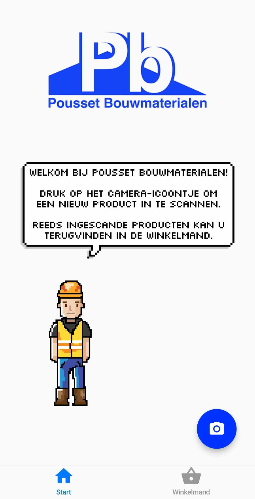
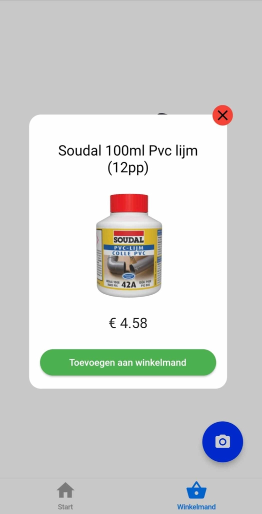
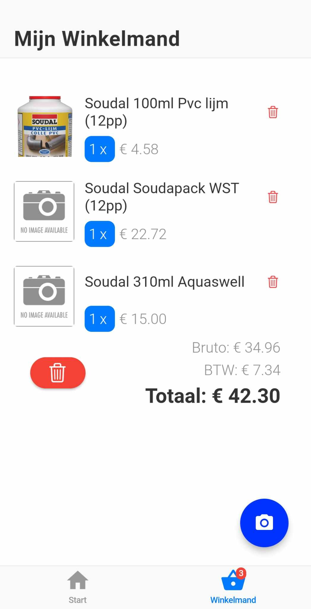

# PriciusScan
**"Pricius"* is derived from the Latin word "pretium" meaning "price" and "Scan" refers to the barcode scanning feature.*
## Project Description
*PriciusScan* is a mobile application originally designed for a small businesses owner, managing a hardware supply store. It enables the store owner to manage product pricing and information without the need for physical price tags. 

The app inplements a barcode scanner, customers can use to access product details, including prices, directly on their smartphones. The app also streamlines the purchasing process by allowing users to compile their desired items in a basket on their smartphone and pay for them at at the counter. 

Built with [Dart](https://dart.dev/) using the [Flutter](https://flutter.dev/) framework, PriciusScan interfaces with the [OnlineFact](https://www.onlinefact.be/) cashier system, fetching item information from the cloud via the OnlineFact API. 

Though this app was devleped for a single store. The application could be rolled out to other stores using the OnlineFact system, by simply changing their API key.

## Preview

